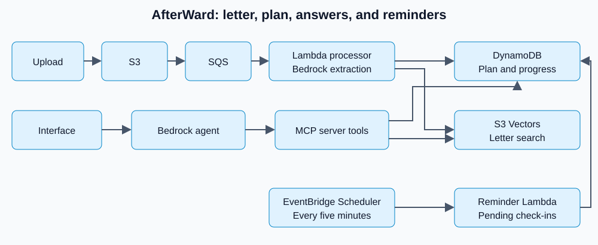

# AfterWard

A living recovery plan for Alexa+.

> **Medical disclaimer:** AfterWard is a hackathon prototype. It does not give medical advice and does not replace your care team.

People leave hospital with a long discharge letter and struggle to remember what to do and when.

## What it does

AfterWard turns a discharge letter into a daily plan for medicines, tasks, appointments, and warning signs.
People can ask questions by voice or text, see the letter passages behind answers, and record completed items.
AWS stores the plan and progress, while reminder checks bring up the next action.

## Demo video

[TODO: add demo video link]

## Architecture



The web app calls a Python bridge. The Bedrock agent calls authenticated MCP tools to read the plan, search the letter, and save progress. Uploads go through S3, SQS, and Lambda. DynamoDB stores plans and events. S3 Vectors stores searchable passages. EventBridge schedules reminder checks.

See [architecture details](docs/architecture.md).

## Tracks entered

- **Alexa+ track:** a simulated voice companion backed by a working MCP server. See the Simulated Alexa+ note below.
- **AWS Builder:** see [AWS integrations](docs/aws-integrations.md) for services and code links.
- **Open Source:** [discharge-letter-check](https://github.com/charvimaurya/discharge-letter-check) is the standalone Python validator split out of AfterWard.

## Built with, and where to find it

| Step | Tag | Where it is | What it does |
| --- | --- | --- | --- |
| 1. Read the letter | `amazon-s3` | [app/aws/s3_service.py](app/aws/s3_service.py), [web/app/api/upload/route.ts](web/app/api/upload/route.ts) | Stores the uploaded discharge letter |
| | `amazon-sqs` | [app/aws/sqs_service.py](app/aws/sqs_service.py), [deployment/redrive-policy.json](deployment/redrive-policy.json) | Queues processing work, keeps failed messages for retry |
| | `aws-lambda` | [lambdas/document_processor/handler.py](lambdas/document_processor/handler.py), [lambdas/reminder_checker/handler.py](lambdas/reminder_checker/handler.py) | Processes letters; checks reminders |
| | `pypdf` | [app/ingestion/pdf_processor.py](app/ingestion/pdf_processor.py) | Reads text from PDF letters |
| 2. Answer from her letter | `amazon-bedrock`, `claude` | [app/ingestion/bedrock.py](app/ingestion/bedrock.py), [app/agent/service.py](app/agent/service.py) | Turns the letter into a plan; runs the agent that calls MCP tools |
| | `amazon-titan` | [app/rag/embeddings.py](app/rag/embeddings.py) | Makes search embeddings of letter passages |
| | `rag` | [app/rag/chunking.py](app/rag/chunking.py), [app/rag/service.py](app/rag/service.py), [app/mcp/tools/rag.py](app/mcp/tools/rag.py) | Finds the exact passage behind each answer |
| | `amazon-s3-vectors` | [app/rag/vector_store.py](app/rag/vector_store.py) | Stores and searches those embeddings, per patient |
| 3. One shared MCP server | `model-context-protocol` | [app/mcp/server.py](app/mcp/server.py), [app/mcp/http_server.py](app/mcp/http_server.py), [app/mcp/tools/](app/mcp/tools/) | 7 tools on MCP spec 2025-11-25 over Streamable HTTP |
| | `python` | [app/](app/) | Server, agent and pipeline code |
| | `docker`, `amazon-ecs` | [Dockerfile](Dockerfile), [ecs-task-definition.json](ecs-task-definition.json) | Runs the MCP server on ECS Fargate |
| | `amazon-cloudfront` | [cloudfront-config.json](cloudfront-config.json), [app/mcp/http_server.py](app/mcp/http_server.py) | Gives the MCP server its HTTPS address |
| 4. Talk to her | `web-speech-api` | [web/lib/voice.ts](web/lib/voice.ts) | Browser voice in and out |
| | `next.js`, `typescript` | [web/app/demo/page.tsx](web/app/demo/page.tsx), [web/app/api/](web/app/api/) | The web demo and its API routes |
| 5. Remember, remind, protect | `amazon-dynamodb` | [app/database/recovery_state.py](app/database/recovery_state.py), [app/database/event_history.py](app/database/event_history.py) | Keeps her plan and history |
| | `amazon-eventbridge` | [deployment/reminder-schedule-target.json](deployment/reminder-schedule-target.json) | Runs the reminder check every 5 minutes |
| | `aws-secrets-manager` | [app/auth/mcp_token.py](app/auth/mcp_token.py) | Holds the MCP server's login token |
| | `aws-iam` | [infra/security/](infra/security/), [deployment/reminder-policy.json](deployment/reminder-policy.json) | Limits what each part can access |
| | `amazon-cloudwatch` | [app/observability/log.py](app/observability/log.py), [infra/observability/template.yaml](infra/observability/template.yaml) | Logs and measurements from each part |

## How judges can test

The quickest way to try AfterWard is the public demo: [TODO: add public demo link]. Running it locally needs your own AWS resources (see Local setup below).

For a local demo, follow the setup below, then open [http://127.0.0.1:3000/demo](http://127.0.0.1:3000/demo).

Before you start, set `CLOCK_MODE=demo` in the root `.env` and restart both Python services. Margaret's plan depends on dates, so on the real clock Today can be empty.

1. Upload `test_data/letter1_margaret_knee_replacement_SYNTHETIC_v4.pdf`. Wait for the new plan to be ready.
2. Open Today. Press **Mark as done** on a medicine or task. Each button saves that item as done.
3. Check the Done-first display. Completed items appear above Next up. The item just completed appears beside the next action.
4. Ask about a medicine or food. Letter-backed answers show an evidence quote-card with a page reference. Food answers cite the letter when it contains relevant diet advice.
5. Check the highlighted wording for the discussed item. When the passage refers to an appointment, its wording appears with the evidence too. Use **Back to today** to return.
6. Open **Developer view** to inspect the conversation and MCP tool calls.
7. Upload `test_data/letter3_kevin_asthma_age30_SYNTHETIC.pdf`. AfterWard builds a new plan from it.
8. Use **Reset demo** in the top bar to clear today's progress and the conversation, then start again. It needs `BRIDGE_KEY` set in both env files (see Settings).

Voice input depends on browser support and microphone permission. Text input is available too.

## Local setup

Requires Python 3.11, Node.js 22.18 or newer, npm, and AWS credentials. The local app uses live AWS resources. It does not start a local AWS emulator. Set up the S3 upload pipeline, DynamoDB tables, Bedrock model access, and S3 Vectors first using [AWS setup](docs/aws-setup.md) and [deployment instructions](deployment/README.md).

Use your normal AWS credential chain. If using a named profile, set `AWS_PROFILE` in every terminal that runs a service. Keep credentials and MCP tokens on the server.

| Part | Address |
| --- | --- |
| MCP server | `http://127.0.0.1:8001/mcp` |
| Python bridge | `http://127.0.0.1:8002` |
| Web app | `http://127.0.0.1:3000/demo` |

The MCP server port comes from the startup command below. Use 8001 for local setup. The bridge uses port 8002.

### macOS

Install dependencies from a fresh clone:

```bash
git clone https://github.com/charvimaurya/AfterWard-A-Living-Recovery-Plan-for-Alexa.git
cd AfterWard-A-Living-Recovery-Plan-for-Alexa
python3.11 -m venv .venv
source .venv/bin/activate
python -m pip install -r requirements-dev.txt
cp .env.example .env
cd web
npm ci
cp .env.example .env.local
cd ..
```

Fill in `.env` and `web/.env.local` as described in Settings below.

Terminal 1, from the repository root:

```bash
source .venv/bin/activate
python -m uvicorn app.mcp.http_server:app --host 127.0.0.1 --port 8001
```

Terminal 2, from the repository root:

```bash
source .venv/bin/activate
python scripts/run_web_bridge.py --port 8002
```

Terminal 3, from the repository root:

```bash
cd web
npm run dev -- --port 3000
```

### Windows PowerShell

Install dependencies from a fresh clone:

```powershell
git clone https://github.com/charvimaurya/AfterWard-A-Living-Recovery-Plan-for-Alexa.git
cd AfterWard-A-Living-Recovery-Plan-for-Alexa
py -3.11 -m venv .venv
.\.venv\Scripts\Activate.ps1
python -m pip install -r requirements-dev.txt
Copy-Item .env.example .env
cd web
npm ci
Copy-Item .env.example .env.local
cd ..
```

Fill in `.env` and `web/.env.local` as described in Settings below.

Terminal 1, from the repository root:

```powershell
.\.venv\Scripts\Activate.ps1
python -m uvicorn app.mcp.http_server:app --host 127.0.0.1 --port 8001
```

Terminal 2, from the repository root:

```powershell
.\.venv\Scripts\Activate.ps1
python scripts/run_web_bridge.py --port 8002
```

Terminal 3, from the repository root:

```powershell
cd web
npm run dev -- --port 3000
```

If PowerShell blocks activation, run `.\.venv\Scripts\python.exe` in place of `python` for Python commands. Activation is not needed with that path.

### Settings

Root `.env.example`, copied to `.env`:

| Setting | Meaning |
| --- | --- |
| `AWS_REGION` | AWS region for the Python services, normally `eu-west-2`. |
| `MODEL_MODE` | `test` uses `TEST_MODEL_ID` for everything; `final` uses `FINAL_EXTRACTION_MODEL_ID` and `FINAL_AGENT_MODEL_ID`. |
| `TEST_MODEL_ID` | Bedrock model or inference profile used for extraction and chat in test mode; must be filled in. |
| `FINAL_EXTRACTION_MODEL_ID` | Bedrock extraction model used in final mode. |
| `FINAL_AGENT_MODEL_ID` | Bedrock model for the chat agent in final mode. |
| `IMAGE_MODEL_ID` | Bedrock model for image transcription; needed for image scripts, not the PDF demo upload. |
| `RECOVERY_STATE_TABLE` | DynamoDB table containing the current recovery plan. |
| `EVENT_HISTORY_TABLE` | DynamoDB table containing completion events and other recorded history. |
| `DOCUMENT_BUCKET` | Existing S3 bucket receiving discharge letters. |
| `PROCESSING_QUEUE_URL` | SQS document-processing queue URL used by queue helpers and checks. |
| `S3_VECTOR_BUCKET` | Existing S3 vector bucket storing letter embeddings. |
| `S3_VECTOR_INDEX` | Vector index name within that bucket. |
| `EMBEDDING_MODEL_ID` | Bedrock embedding model used for indexing and search. |
| `EMBEDDING_DIMENSIONS` | Embedding size, which must match the vector index dimensions. |
| `MCP_AUTH_TOKEN` | Local MCP bearer token used by the bridge and checked by the server. |
| `MCP_AUTH_TOKEN_SECRET_ARN` | Secrets Manager token secret for deployment; leave blank for local token authentication. |
| `MCP_ALLOWED_ORIGINS` | Comma-separated origins accepted by the MCP transport. |
| `CLOCK_MODE` | `real` uses current patient-local time; `demo` fixes time; `production` disables test hooks. |
| `DEMO_FIXED_NOW` | ISO timestamp used only in demo clock mode. |
| `MCP_URL` | Address the Python bridge uses to reach the MCP server. Keep `http://127.0.0.1:8001/mcp` for local setup. |
| `BRIDGE_KEY` | Shared key the web server sends to the bridge; must match `web/.env.local`. Needed for **Reset demo**. |

Web `web/.env.example`, copied to `web/.env.local`:

| Setting | Meaning |
| --- | --- |
| `AWS_REGION` | AWS region for the web server's S3 and DynamoDB clients. |
| `DOCUMENT_BUCKET` | Upload bucket name; must match the root `.env`. Uploads stop with a message naming this setting if it is missing. |
| `RECOVERY_STATE_TABLE` | Recovery table; match the Python configuration. |
| `TEST_PATIENT_ID` | Synthetic demo patient ID; keep `demo_patient_001` for the supplied demo. |
| `AGENT_API_URL` | Optional. Python bridge address; defaults to `http://127.0.0.1:8002`. |
| `BRIDGE_KEY` | Same value as the root `.env`. Server-only; never prefix it with `NEXT_PUBLIC_`. |

To make a `BRIDGE_KEY`, run `python -c "import secrets; print(secrets.token_urlsafe(32))"` and paste the output into both files.

## Load and reset the demo patient

Upload `test_data/letter1_margaret_knee_replacement_SYNTHETIC_v4.pdf` through `/demo` first. This creates the recovery plan for `demo_patient_001`. The reset script does not upload or extract a letter and fails if no plan exists. Or use **Reset demo** on `/demo`, which runs the same reset.

For a repeatable recording, set `CLOCK_MODE=demo` in the root `.env`. The supplied `DEMO_FIXED_NOW` is `2026-10-23T07:00:00+01:00`. Restart both Python services after changing settings.

From the repository root, with the virtual environment active on either platform:

```sh
python scripts/reset_demo_patient.py --confirm
```

This clears the demo patient's current-date completions and check-in state. It keeps the letter and plan. It uses the same configured clock as the app. Refresh Today after the reset.

## Run tests

From the repository root, with the virtual environment active:

```sh
pytest -q
cd web
npm test
```

Default pytest discovery excludes live AWS integration tests. The web tests use Node's built-in TypeScript support. See [testing details](docs/testing.md).

## Known limitations

- Uploading a new letter replaces the plan, but the conversation on screen stays. Reload the page to start a fresh conversation.
- If AfterWard cannot clear the old letter's saved history during a new upload, the upload still goes ahead. The upload reply then includes `history_cleared=false`, and the web server logs the error.

## Simulated Alexa+

This demo uses browser speech input and speech output with a Bedrock agent and real MCP tools. It simulates the Alexa+ experience. It is not a deployed Alexa+ add-on. Amazon's [Alexa+ developer documentation](https://developer.amazon.com/docs/alexaplus/add-ons/home.html) says the Category SDK and MCP Toolkit are available only to selected partners.

## Synthetic data only, no real patients

All demo patients and documents are synthetic. Use only the supplied synthetic letters when testing.

## Licence

[MIT licence](LICENSE). Copyright 2026 Charvi Maurya and Shilpa Agarwal.
